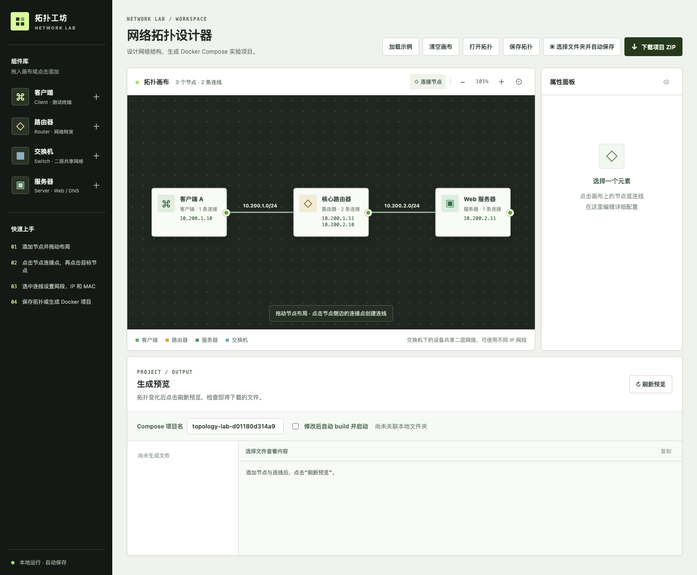

# 拓扑工坊

一个基于浏览器的 Docker 网络实验拓扑编辑器。在画布上放置客户端、服务器、路由器和交换机，配置网络和服务，然后生成可运行的 Docker Compose 项目。



## 功能概览

- **可视化组网**：通过连线配置网段、接口 IPv4 和 MAC 地址，画布直接显示节点的地址信息。
- **网络实验**：使用 OpenWrt 路由器、静态路由和流量镜像，搭建跨网段实验。
- **服务实验**：服务器可选择 Apache 或 Nginx 提供 HTTP，并提供 SSH、Telnet、FTP 服务；也可启用 BIND9 配置权威 DNS、递归解析和实验域名转发。
- **桌面节点**：客户端和服务器可选用带浏览器访问界面的 GUI 桌面容器。
- **保存与分享**：保存拓扑 JSON、下载生成项目 ZIP，或关联本机文件夹自动同步生成文件。

画布中的交换机是逻辑节点，表示共享的 Docker bridge 网络，不单独创建容器或分配 IP。生成预览可通过页面上的“刷新预览”查看。

## 快速开始

需要 Python 3.10 或更新版本，无须额外安装 Python 依赖。在项目目录中运行：

```bash
python3 app.py
```

在浏览器中打开 [http://127.0.0.1:8080](http://127.0.0.1:8080)，添加节点并连线，然后预览或导出项目。

也可使用 Docker 运行编辑器：

```bash
docker compose up --build -d
```

打开 [http://localhost:8080](http://localhost:8080)。Docker 运行模式下，文件夹由浏览器直接写入本机；自动执行 Compose 仅在 macOS 上直接运行 `python3 app.py` 时可用。

## 保存与打开拓扑

点击**“保存拓扑”**会打开系统保存对话框，并导出一个可重新打开的 JSON 文件。该文件保存原始画布数据，因此尚未连线的草稿也能保存；它与 Docker 项目内用于记录生成结果的 `topology.json` 用途不同。

点击**“打开拓扑”**选择之前保存的 JSON。文件只有在格式、版本、节点 ID 和连线端点校验通过后才会替换当前画布。浏览器不支持系统文件选择 API 时，保存会退化为普通 JSON 下载，打开会使用网页文件选择框。

## 关联文件夹并自动保存（推荐）

在网页中调整节点和连线，然后点击**“选择文件夹并自动保存”**。选定目录后，当前拓扑对应的 `compose.yaml`、`.env`、各节点 Dockerfile 和脚本会写入该目录，使用路由器时也会写入 OpenWrt rootfs。之后的有效修改会自动同步，无需再选文件夹或输入路径。可随时点击“更换文件夹”或“停止同步”。

目录中存在同名文件时，首次关联会列出待覆盖文件并要求确认；关联后再次修改会自动覆盖生成文件。不会主动清理其他文件。因此删除节点后，旧 Dockerfile 可能仍留在磁盘上，但不再被新 `compose.yaml` 引用。需要保留的手工修改应放在其他文件中。

在 macOS 上直接运行 Python 编辑器时，使用系统文件夹对话框，服务器能够定位所选目录，因此可以启用“修改后自动 build 并启动”。此选项会在同步后依次执行 `docker compose build` 和 `docker compose up -d --remove-orphans`；当已由本次关联启动的项目的 Compose 配置发生变化时，还会先停止旧项目以重建网络。页面会实时显示写入、检查、构建和启动阶段的进度条，并可展开查看 Docker 输出；构建百分比根据 Docker 报告的已完成步骤估算。如果同一文件夹中有其他项目名的容器仍在运行，页面会先提示确认替换，避免网段冲突和意外删除容器内修改。Docker 命令失败会显示在页面状态栏和进度区域。

在 Docker 容器内运行编辑器时，使用浏览器的文件夹选择器直接写入本机目录，浏览器不会提供真实路径给编辑器容器，因此不能自动执行 Docker Compose。此模式需要 Chrome 或 Edge 的 File System Access API，以及 `http://127.0.0.1:8080` 或 `http://localhost:8080` 这样的安全上下文。

“Compose 项目名”可直接修改，允许小写字母、数字、`-`、`_`，且须以小写字母或数字开头，最多 63 个字符。名称改变后，生成的 `compose.yaml` 第一行会随之更新。

生成完成后，在目标目录重建容器：

```bash
cd /path/to/your/lab
docker compose down
docker compose up -d --build
docker compose ps
```

`driver_opts` 等网络配置不能原地修改，因此更新已有实验目录后需要先执行 `docker compose down`，再重新启动，让 Docker 重建网络。

拓扑会保存 Compose 项目名，重新打开或复制同一拓扑时会沿用该名称。若要同时运行多个实验，请为它们设置不同的项目名，并确保节点生成的容器名称互不冲突、各实验网段不重叠。

如需确保完全重新构建镜像，可运行：

```bash
docker compose build --no-cache
docker compose up -d --force-recreate
```

> 自动构建启动默认关闭；启用前请确认 Docker Desktop 正在运行。自动模式会重建镜像，并在 Compose 配置改变时重建已由本次关联启动的容器与网络。

## 下载 ZIP 与运行生成的拓扑

“下载项目 ZIP”功能仍然保留，适合将实验分享给其他机器。解压 `topology-lab.zip` 后，在解压目录运行：

```bash
docker compose up -d --build
docker compose ps
# 实验结束后
docker compose down
```

在实际测试中，请使用前端所设的节点 IP，例如：

```bash
docker exec -it client1 bash
ping -c 3 192.168.2.11
curl http://192.168.2.11
```

以上节点名和 IP 只是示例，应按当前拓扑修改。服务器默认运行 Apache HTTP Server，也可在节点属性中选择 Nginx；两者使用 80 端口，网站目录为 `/var/www/html`。服务器还会运行 OpenSSH、Telnet 和 vsftpd：SSH 使用 22 端口，Telnet 使用 23 端口，FTP 使用 21 端口及被动端口 30000–30009。

## 服务器 Web、SSH、Telnet 与 FTP

新建服务器节点后，可在属性面板选择 Apache 或 Nginx 作为 Web 服务（默认 Apache）；每台服务器可独立选择。更换后请重新生成并重建容器。属性面板还会显示服务器 IP、用户名 `lab` 和随机密码，并可一键复制。该密码随拓扑保存，并写入生成项目的 `.env` 中作为 `SERVER_PASSWORD`。所有服务器节点共用这组实验账户信息。

拓扑启动后，可从能够到达该服务器 IP 的节点连接：

```bash
ssh lab@192.168.2.11
telnet 192.168.2.11 23
ftp 192.168.2.11
curl http://192.168.2.11/
```

FTP 支持本地用户读写，默认目录是 `/home/lab`，被动模式使用容器内部的 30000–30009 端口。服务仅通过拓扑网络地址访问，生成器不会把 SSH、FTP 或 HTTP 端口发布到宿主机。

## DNS 实验

可以在服务器节点的属性面板中启用“DNS 实验服务”，设置区域名称和 DNS 记录。例如设置区域 `example.test`，逐行填写：

```text
www A 10.200.2.11
alias CNAME www.example.test.
```

名称可以是区域内的相对名称、完整域名，或用 `@` 表示区域本身；CNAME 目标必须指向该区域中已有的 A 记录，区域顶点不能设置为 CNAME。启用后，服务器安装 BIND9 并为区域生成 SOA、NS 和指定的记录。默认作为权威服务器运行，关闭递归查询。需要时可在属性面板启用递归解析。修改页面配置后需重新生成并重建容器。

生成项目的 `dns/<服务器节点ID>/` 目录包含 BIND 配置和区域文件。它们分别复制到容器内的 `/etc/bind/named.conf`、`/etc/bind/named.conf.options`、`/etc/bind/named.conf.local` 和 `/etc/bind/db.topology`。可以修改容器内文件进行实验；例如，在服务器容器内验证并重新加载配置：

```bash
named-checkconf -z
named-checkzone example.test /etc/bind/db.topology
pkill -HUP -x named
```

将 `example.test` 替换为实际区域名。只在容器内的修改在容器重建后会丢失；也可以修改生成项目中的相应文件并重建，但重新生成项目时这些文件会被覆盖。

在需要使用该服务的客户端或服务器节点的“本节点使用的 DNS 服务器 IPv4”中，填写 DNS 服务器的拓扑 IP。确保节点之间有可用的网络路径；留空则使用 Docker 的默认解析。Docker 自定义网络可能在 `/etc/resolv.conf` 中显示内置解析器 `127.0.0.11`，并将查询转发给配置的 DNS 服务器。

启动拓扑后，在客户端容器中验证（按实际节点名和 IP 替换）：

```bash
docker exec -it client1 bash
dig @10.200.2.11 www.example.test A
dig @10.200.2.11 alias.example.test CNAME
nslookup www.example.test
```

### 递归 DNS 实验

在服务器节点启用 BIND9 DNS 服务后，勾选“启用递归解析”。BIND9 会从根服务器开始逐级查询，缓存查询结果；递归查询仅允许来自拓扑网段和本机。权威区域和递归功能可以同时启用；若只需要递归服务器，将区域名称和记录都留空。

如果要让递归服务器查询拓扑中的独立权威服务器，可以在“实验域名转发”中每行填写一个域名和该权威服务器的 IP，例如：

```text
example.test 10.200.2.11
```

例如将上述记录配置在递归服务器上，并在 `10.200.2.11` 的权威服务器上配置 `example.test` 后，客户端向递归服务器查询：

```bash
dig @<递归服务器IP> www.example.test A
```

这个实验域名会转发给指定的权威服务器；其他域名仍由递归服务器从根开始查询。为支持未签名的本地实验区域，配置的转发域名不进行 DNSSEC 验证；其他递归查询保留 DNSSEC 自动验证。请确保客户端、递归服务器和权威服务器之间的路由可达，并允许 UDP 和 TCP 的 53 端口。

查询公网域名还需要递归服务器能访问根服务器及其他权威服务器，并能收到返回流量。生成的 Docker bridge 默认关闭 IP 伪装，外部网络需要有返回实验网段的路由；仅启用递归选项并不保证能够访问公网。

## 容器名称与交互式 Bash

生成的**容器名称**优先使用拓扑画布上的节点名称，例如节点名 `attacker`、`client1`、`server`，即可直接：

```bash
docker exec -it attacker bash
docker exec -it client1 bash
```

Docker 容器名称不允许任意字符：含空格的名称会替换非法字符，无法转换成有效 ASCII 名称的节点会回退至节点 ID。转换后如有重名，生成器会报错；原始画布名称会保留在 Docker label 中。容器 hostname 对符合 DNS 主机名规则的节点名称使用原名，否则回退至节点 ID。因此建议为需要终端操作的设备使用不重复的英文、数字或连字符名称。

非 GUI 客户端和服务器基于 Ubuntu 24.04，预装 `bash`、命令补全和常见 Linux/网络工具（如 `ip`、`ping`、`curl`、`ssh`、`telnet`、`ftp`、`nc`、`tcpdump`、`vim`、`traceroute` 等），默认工作目录为 `/root`，交互式 Bash 提示符采用 `root@hostname:~#` 风格。它们仍是容器，而不是拥有独立内核的完整虚拟机。

**OpenWrt 路由器除外**：路由器保留 rootfs 自带的 Shell，通常应使用 `docker exec -it <路由器容器名> sh`。

## 网络模型

- **交换机共享二层网络：**接到同一交换机的客户端、服务器和路由器接口处于同一个 Docker bridge 二层网络，可以各自配置不同的 IP 网段。选中设备与交换机之间的连线即可单独修改网段；新连线默认沿用已有设备的网段。交换机之间直接相连时，其二层域合并为同一个 bridge，不改变已有接口地址。交换机是逻辑节点，**不单独创建交换机容器**，也不分配三层 IP。
- **直接连接：**未通过交换机的旧式设备直连链路，仍可各自对应独立 Docker bridge 网络；客户端和服务器最多接入一个网络，路由器可以接入多个网络。
- **IP 与网关：**每个实验子网的首个可用主机地址（如 `192.168.2.1`）保留，节点需使用其余可用地址。同一二层网络内的同网段设备可以直接通信；不同网段即使连接同一交换机也需要路由。当前同一路由器不能通过两条连线重复接入同一个交换机二层域；如需在该二层域内路由不同网段，需要在运行时手动配置路由器的额外接口地址和路由。
- **静态路由：**生成器为需要的设备配置非直连网段的静态路由，路由器启用 IPv4 转发。只有可通过路由器到达的网段才会生成有效路由；不可达情况会在预览和生成项目的 README 中提示。
- **关闭 IP 伪装：**所有生成的 Docker bridge 网络都会设置 `com.docker.network.bridge.enable_ip_masquerade: "false"`。容器流量离开 bridge 时保留原始源 IP；如需访问外部网络，外部设备必须具备返回该实验网段的路由。
- **配置校验：**生成时会检查 IP、MAC、网段冲突及节点连接数等问题。

由于 Docker bridge 不支持直接配置多个 IPv4 子网，多网段交换机会使用 `198.18.0.0/15` 中的一个辅助 `/24` 网络；启动时再为各设备添加拓扑中配置的实验 IP 和掩码。辅助地址会显示在容器接口和 Docker 检查结果中，并被配置为不能用于容器间直接通信，以免绕过实验网段路由。Docker 内置的容器名称解析可能返回这些不可直连的辅助地址；实验时请使用拓扑中配置的 IP。生成器会避免与当前拓扑的实验网段重叠；如果辅助网段与宿主机上已有的 Docker 网络冲突，可在生成的 `compose.yaml` 中将该 bridge 的子网改为未占用且不与实验网段重叠的 `/24`，然后重建网络。

## 路由器流量镜像

选中路由器，在属性面板启用“流量镜像”，依次选择通信节点 A、通信节点 B 和镜像接收节点。三个节点可以经交换机连接，但都必须与这台路由器处于直接相连的网段；通信两端应在不同网段，且各自网段只连接这台路由器，以确保流量经过它。接收节点必须是客户端或服务器。

生成器会在 OpenWrt 路由器中安装 nftables 规则，复制 A ↔ B 两个方向的 IPv4 报文到接收节点，同时关闭接收节点的 IP 转发，避免副本被再次路由。接收端使用 `tcpdump -ni any` 查看报文；镜像副本保留原始 IP 头，不会交给接收端普通应用处理。例如：

```bash
docker exec -it <接收节点容器名> tcpdump -ni any 'host <A的IP> and host <B的IP>'
```

修改镜像设置后，重新构建并启动生成项目，新的规则才会生效。

## OpenWrt 路由器

路由器使用项目提供的 OpenWrt ARM64 rootfs。需将归档放在编辑器项目中的：

```text
assets/openwrt-armsr-armv8-rootfs.tar.gz
```

生成的路由器 Dockerfile 以 `FROM scratch` 为基础并指定 `linux/arm64`；需在 ARM64 宿主机或支持 ARM64 模拟的 Docker 环境运行。随项目使用的 OpenWrt SNAPSHOT rootfs 只建议用于隔离的本地实验网络，**不要把其管理服务直接暴露在公网**。

## GUI 桌面节点

客户端和服务器可在节点属性中启用 GUI；此时使用 `kasmweb/ubuntu-focal-desktop:1.16.0`。GUI 镜像会安装 `ping`、`ip`、`curl`、`wget`、`ssh`、`telnet`、`ftp`、`nc`、`traceroute`、`tcpdump`、`nmap`、`vim` 等常用工具。启用后，属性面板会立即显示访问地址、用户名 `kasm_user` 和随机生成的密码，并可一键复制。该密码会保存在拓扑中并同步写入生成项目的 `.env`，确保页面提示与实际容器一致。网页登录名是 `kasm_user`，桌面内的 Linux 账户是 `kasm-user`；在桌面终端执行 `sudo -i` 即可免密进入容器内 root。访问 `https://localhost:<端口>`；此功能要求 Docker Compose v2.30+ 支持 `post_start`。GUI 服务器同样提供所选的 Apache 或 Nginx，以及 OpenSSH、Telnet 和 vsftpd。

## 安全与注意事项

本项目用于本地、隔离的网络实验。生成的客户端、服务器和路由器容器均设置 `privileged: true`，可以在容器内修改网络、服务和系统配置；交换机是 Docker bridge，不创建容器。该模式会授予容器完整 capabilities 和宿主设备访问能力，请勿直接用于生产环境。只在运行中修改的内容会在容器重建后丢失，需要长期保留的改动应写入 Dockerfile 或挂载卷。每次修改生成器代码后，需要重启 `python3 app.py`；每次更新实验目录中的 Dockerfile 后，需要重新构建相关镜像或启用页面上的自动构建。
